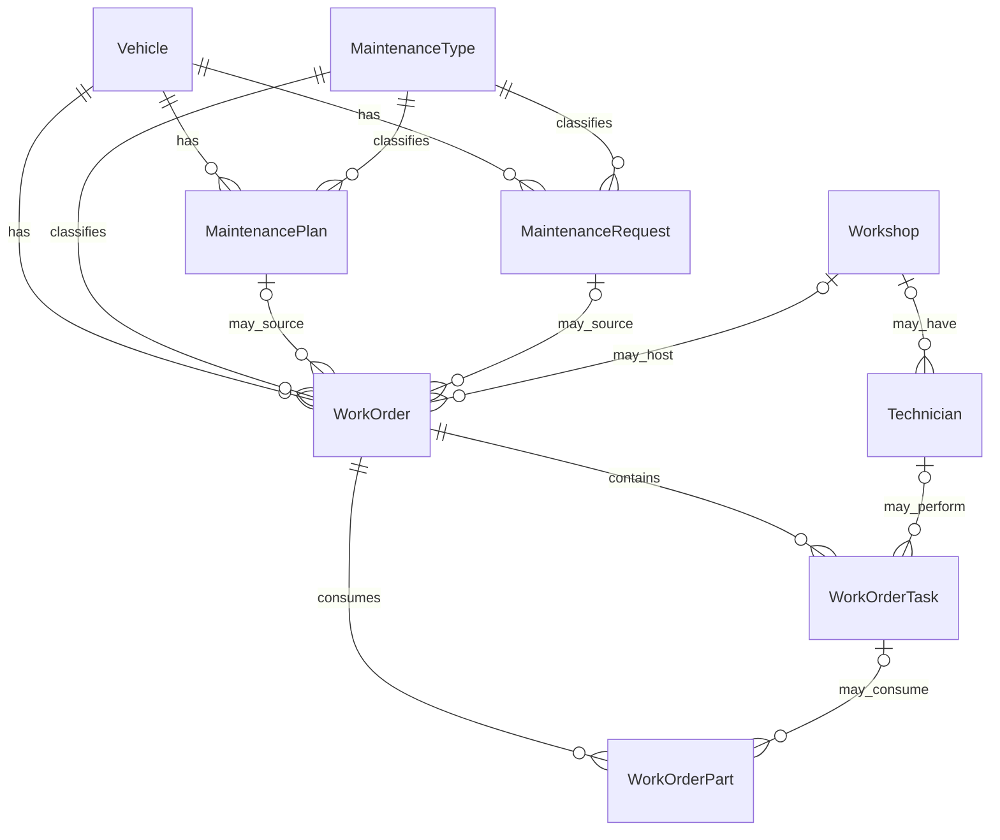

# Maintenance and inventory: database contract and approved implementation

This document separates the existing SQL Server contract from the application
behavior approved by the user on 2026-11-01. Approval covers the staged feature
implementation described below, not schema changes, migrations, unapproved seed data,
permission changes, commits or pushes. SQL Server remains the model authority.

## Source and scope

SQL Server metadata was read directly, including columns, identities, defaults,
foreign keys, indexes, CHECK constraints, computed columns and triggers. The
connection has database-level `VIEW DEFINITION`. Prisma CLI and runtime settings
resolve to the same server, port and database.

The review on 2026-11-01 connected to `FleetManagementDB_Development`.
The business schemas are `common`, `driver`, `fleet`, `inventory`,
`maintenance`, `person` and `trip`: 36 tables in total. `dbo.sysdiagrams`
is the only other visible user table and remains outside the application model.
The initial datasource omitted `inventory`, so an initial pull could see only
30 models. After discovering all schemas through SQL metadata, adding the
existing `inventory` schema to the local datasource and running `prisma db pull`
imported its six tables. No DDL or data writes were performed.

Compared with the working schema at the start of this review, the additions are
`Part`, `PartCategory`, `PartVehicleCompatibility`, `StockTransaction`, `Unit`
and `Warehouse`, plus the inverse compatibility relation on `VehicleModel`.
The eight maintenance models and other pre-existing models have no semantic
change in that comparison. The working tree already contained the maintenance
models and this document before this review; those changes were preserved.

All eight maintenance and all six inventory tables were empty, verified with
`COUNT_BIG`, including their reference catalogs. Consequently catalog codes,
transaction types, statuses, priorities and workshop/location classifications
cannot be inferred from existing rows. Stored module metadata contains no
business triggers, views, stored procedures, functions, sequences or synonyms;
the only modules found belong to SQL Server diagram support under `dbo`.

## Relationships

There are 14 maintenance foreign keys. All are enabled and trusted, with
`NO_ACTION` on update and delete; none cascades deletion.

## Tables and fields

Unless stated otherwise, primary keys are `int IDENTITY`. Optional fields below
are nullable. SQL text lengths are character counts, not `sys.columns.max_length`
byte counts. SQL Server remains the authority when Prisma does not expose all
metadata in its schema.

### MaintenanceType: classification catalog

- `MaintenanceTypeId`: `tinyint` primary key, **not** Identity.
- `TypeCode`: required `varchar(50)`, unique.
- `TypeName`: required `nvarchar(100)`.
- `Description`: optional `nvarchar(500)`.
- `IsActive`: required `bit`, database default true.

The database does not define catalog classifications or seed values. In the
approved application, staff enter codes and Persian labels; no catalog rows
are invented or seeded. Infrastructure allocates an available identifier from
1 through 255 under a transaction-scoped lock because this key is not Identity.

### Workshop: place or provider of repair work

- `WorkshopName`: required `nvarchar(150)`.
- `WorkshopType`: required `nvarchar(50)`, unrestricted text.
- `IsInternal`: required `bit`, default false.
- Optional `Address nvarchar(500)`, `Phone nvarchar(50)`,
  `ContactPerson nvarchar(150)`, `Description nvarchar(1000)`.
- `IsActive`: required, default true; `CreatedAt`: database `sysdatetime()`.

One workshop can have many technicians and work orders. No unique workshop name
or CHECK defining `WorkshopType` is present.

### Technician: person performing a task

- Optional `WorkshopId` foreign key.
- Required `FirstName` and `LastName`: `nvarchar(100)` each.
- Optional `Mobile nvarchar(20)`, `Specialty nvarchar(150)`,
  `Description nvarchar(1000)`.
- `IsActive`: default true; `CreatedAt`: database `sysdatetime()`.

A technician is independent of `person.People` and `driver.Driver`: there is no
foreign key connecting those identities. A task can have at most one technician;
a technician can perform many tasks. A technician need not belong to a workshop.

### MaintenancePlan: recurring service definition for one vehicle

- Required `VehicleId`, `MaintenanceTypeId`, `PlanTitle nvarchar(200)`.
- Optional `Description nvarchar(1000)`.
- Optional intervals: `IntervalKm decimal(18,2)`, `IntervalDays int`,
  `IntervalEngineHours decimal(18,2)`.
- Optional warning thresholds: `WarningKm decimal(18,2)`, `WarningDays int`,
  `WarningEngineHours decimal(18,2)`.
- Optional last-service baseline: `LastServiceOdometer decimal(18,2)`,
  `LastServiceDate date`, `LastServiceEngineHour decimal(18,2)`.
- `IsActive`: default true; `CreatedAt`: database `sysdatetime()`.

`CK_MaintenancePlan_Interval` requires at least one interval to be non-null. It
does **not** require a positive interval, constrain warnings or define how multiple
intervals combine. Multiple plans for the same vehicle/type are allowed.

There is no next-due column, reminder table, automatic scheduler, trigger or
automatic last-service update. A plan can be linked to many work orders.

### MaintenanceRequest: reported problem or need for service

- Required `VehicleId`, `MaintenanceTypeId`.
- `RequestDateTime` and `CreatedAt`: database `sysdatetime()` defaults.
- Optional `ProblemDescription nvarchar(1000)`,
  `ReportedOdometer decimal(18,2)`, `ReportedEngineHour decimal(18,2)`,
  `Priority nvarchar(50)`, `Description nvarchar(1000)`.
- Required `Status nvarchar(50)`: SQL default `Open`.

No requester/person/driver reference, request number, plan reference, approval
identity, cancellation reason or dedicated attachments exist. One request may
have zero, one or multiple work orders; there is no one-to-one constraint.

### WorkOrder: central record of an actual maintenance operation

- Required `WorkOrderNo nvarchar(50)`, `VehicleId`, `MaintenanceTypeId`,
  `WorkLocationType nvarchar(50)`.
- Optional `MaintenancePlanId`, `MaintenanceRequestId`, `WorkshopId` foreign keys.
- `OpenDateTime` and `CreatedAt`: database `sysdatetime()` defaults.
- Optional `ActualStartDateTime`, `ActualEndDateTime`: `datetime2(7)`.
- Optional `Odometer`, `EngineHour`: `decimal(18,2)`.
- Optional `ProblemDescription`, `Diagnosis`, `FinalDescription`, `Description`:
  `nvarchar(1000)` each.
- Required `Status nvarchar(50)`: SQL default `Open`.

Both source links may be null, either may be set, or both may be set. SQL does
not require matching vehicle/type across a linked plan, request and work order.
There is no unique work-order number, number sequence, one-open-order-per-vehicle
constraint, status CHECK, date-order CHECK or automatic vehicle-status update.
Location type has no CHECK tying it to a required workshop.

### WorkOrderTask: individual work item and labor

- Required `WorkOrderId`, `TaskTitle nvarchar(200)`.
- Optional `TechnicianId`, `LaborHours decimal(10,2)`,
  `LaborCost decimal(18,2)`, `Description nvarchar(1000)`.
- Required `Status nvarchar(50)`: SQL default `Open`.
- `CreatedAt`: database `sysdatetime()`.

No hourly rate, labor-cost formula, task timing or multi-technician assignment
table exists. SQL does not enforce that the technician's workshop matches the
work order's workshop.

### WorkOrderPart: quantity and price of a consumed part

- Required `WorkOrderId`, `PartId int`, `Quantity decimal(18,2)`.
- Optional `WorkOrderTaskId`, `UnitPrice decimal(18,2)`,
  `Description nvarchar(1000)`.
- `TotalPrice`: nullable `decimal(37,4)`, a **persisted computed column** defined
  as `Quantity * UnitPrice`. It must never be supplied in a write.
- `CreatedAt`: database `sysdatetime()`.

`PartId` still has **no foreign key**, although `inventory.Part` now exists.
That catalog is the approved source for the selector, through an Application
contract rather than an SQL-enforced relation. Infrastructure
must map an explicit catalog lookup through an Application port. Prisma cannot
include a nonexistent relation. There is no part name/code/unit snapshot here.

A part may be linked directly to an order or to one of its tasks. SQL does not
ensure that a referenced task belongs to the same order. Neither this row nor
`inventory.StockTransaction` contains a link to the other, and this row has no
`WarehouseId`. No automatic stock deduction exists. Supplier, purchase order,
invoice, payment and tax models remain absent from the database.

## Important persistence details

- Beyond primary keys, the only maintenance index found is the unique index on
  `MaintenanceType.TypeCode`. `WorkOrderNo` is not unique.
- The only maintenance CHECK found is the non-null interval CHECK above.
- No maintenance triggers, stored procedures, views, sequences, functions or
  synonyms were found.
- Prisma introspects the three SQL status defaults as `@default("N'Open'")`.
  SQL Server's real default is the value `Open`, not the text `N'Open'`. Existing
  code already documents the same provider issue for violation status. Before
  adding maintenance writes, persistence must explicitly handle the verified
  `Open` value or delegate to SQL in a way that preserves its real default.
- Prisma exposes `TotalPrice` as an ordinary optional Decimal without recording
  its computed-column definition. Future Infrastructure write mappings must omit
  it and test this against the isolated integration database.
- SQL `sysdatetime()` is server local time without an offset. A read of
  `SYSDATETIMEOFFSET()` returned offset `Z` and matched `SYSUTCDATETIME()` at this
  inspection. This is evidence about the present host, not a timezone guarantee
  across deployments. Preserve database-managed timestamps and agree a UTC
  contract for application-supplied instants; Presentation displays Tehran time.
  `date` service baselines remain calendar dates, without timezone conversion.
- Decimal values must retain the repository's exact string-based handling.
  Nullable costs must not silently become zero. SQL does not define currency;
  the established site convention is toman (README / shared `MoneyInput`). Use
  that convention for new UI unless existing imported amounts require a separate
  decision; do not silently convert stored amounts.

## Approved workflow and SQL boundaries

The approved application supports these entry paths:

1. Corrective work: report a problem on a vehicle, assess it, open a work order,
   record diagnosis, tasks and parts, then record the result and close the work.
2. Preventive work: define a vehicle plan and its baseline, evaluate its due
   thresholds, open a work order linked to the plan, perform the service and
   update the appropriate baseline when the agreed completion rule is met.

Direct orders with neither source are offered. The application writes at most
one source link, although SQL also permits both. Existing dual-source records
remain visible and are reported as a contract conflict rather than rewritten.

A due calculation compares verified readings/date with last service plus
interval. Reaching any configured threshold is sufficient. Missing baselines or
readings remain explicit; they are not replaced by the plan creation date.
Only successful completion of the linked service updates that plan's baseline.
`fleet.Vehicle` has current readings and `fleet.VehicleMeterReading` has a dated
history. The application must coordinate these; SQL has no automatic maintenance
baseline update.

`Open`, `InProgress`, `Completed` and `Cancelled` are approved application
statuses, with Persian Presentation labels. Only `Open` is a database default;
the other transitions are Application responsibilities. Request, order and task
have independent statuses and must not be treated as a single lifecycle.

## Inventory contract

Lengths below are SQL character counts. All inventory foreign keys are enabled,
trusted and `NO_ACTION` for update/delete. There are six foreign keys, no CHECK
constraints and no secondary indexes beyond the six primary keys. In particular,
`PartCode`, `WarehouseCode`, `CategoryName` and `UnitName` are not unique.

### Part: catalog, not a stock balance

- `PartId`: `int IDENTITY` primary key.
- Required `PartCode nvarchar(50)`, `PartName nvarchar(150)` and `UnitId int` FK.
- Optional `PartCategoryId int` FK, `PartNumber nvarchar(100)` and
  `Manufacturer nvarchar(100)`.
- Optional `MinStock`, `MaxStock`, `ReorderPoint`: `decimal(18,2)`.
- Required `IsActive bit`, database default true.

There is no current-stock field, warehouse-specific threshold, price master,
unit conversion, serial/batch/lot, expiration date or vehicle-specific fitting
record. Thresholds belong to the part globally; choosing how to compare them
with balances across warehouses is a product decision. Changing a used part's
unit or identity can reinterpret history because transaction rows contain no
unit/name snapshot; define edit restrictions before writes.

### PartCategory

- `PartCategoryId`: `int IDENTITY` primary key.
- Required `CategoryName nvarchar(100)`.
- Required `IsActive bit`, default true.

Flat categories only: no parent category, code, ordering or description column.

### Unit

- `UnitId`: `int IDENTITY` primary key.
- Required `UnitName nvarchar(50)`; optional `Symbol nvarchar(20)`.

There is no `IsActive`, conversion factor or integer-quantity flag. Do not copy
an active toggle or impose whole-number quantities from another catalog.

### Warehouse

- `WarehouseId`: `int IDENTITY` primary key.
- Required `WarehouseCode nvarchar(50)`, `WarehouseName nvarchar(150)`.
- Optional `Location nvarchar(500)` (text, not a `common.Location` FK).
- Required `IsActive bit`, default true.

No warehouse hierarchy, bins, keeper/person reference or workshop relation.

### StockTransaction: one movement row

- `StockTransactionId`: `bigint IDENTITY` primary key; carry as a string at
  transport boundaries rather than a potentially unsafe JavaScript number.
- Required `WarehouseId` and `PartId`: `int` foreign keys.
- Required `TransactionDate datetime2(7)`, default `sysdatetime()`.
- Required `TransactionType nvarchar(50)` and `Quantity decimal(18,2)`.
- Optional `UnitPrice decimal(18,2)`, `Description nvarchar(500)`.

No status, posting/reversal marker, source document, transfer pairing,
work-order link, creator, external idempotency key, computed total, reservation
or materialized balance exists. No CHECK defines type codes, sign or positivity.
The opening balance must be represented by an agreed movement type if this
ledger is used as the balance source. Balance queries must aggregate **all**
relevant movements, independently of the visible list's date filter/pagination.
Unknown types must not silently be counted as receipts or ignored.

Approved movement codes and their effects are specified below. A transfer would
need a coherent pair of movements and a pairing strategy, and is excluded from
this implementation. Valuation (FIFO/average/etc.) cannot be inferred from
`UnitPrice` and is excluded. A stock balance is not an accounting valuation.

### PartVehicleCompatibility: blocked write contract

- Composite primary key: (`PartId`, `VehicleModelId`).
- Both fields are required `int` FKs to `Part.PartId` and
  `fleet.VehicleModel.ModelId` respectively.
- Optional `Description nvarchar(500)`.
- **`PartId` is also an `IDENTITY(1,1)` column**, confirmed directly from
  `sys.identity_columns`, and retained as `@default(autoincrement())` by Prisma.

This conflicts with the normal operation of assigning an existing part to one
or more selected vehicle models: SQL Server normally rejects an explicit
identity value, and an omitted value generates an unrelated part identifier.
Do not build compatibility writes, use `IDENTITY_INSERT`, omit the chosen part,
or hide the problem in a repository. Ask the database owner to confirm intent.
If an ordinary many-to-many link is intended, removing identity requires a
separate approved SQL Server change followed by another pull. Read-only display
and other independent slices can proceed. A policy for no compatibility rows
(unknown versus universally compatible) also requires agreement.

## Contract gaps and approved handling

| Issue | Evidence / consequence | Approved handling |
| --- | --- | --- |
| Compatibility identity | Existing-part link cannot be written normally | Read-only; no Identity workaround or schema change |
| Part consumption source | `WorkOrderPart.PartId` lacks FK | Validate against `inventory.Part` through an Application port; no new FK |
| Inventory-to-order trace | Neither table links movement to consumption; no warehouse on consumption | Separate manual records with explicit Persian notices; no automatic deduction |
| Movement semantics | Empty ledger, no type CHECK or sign convention | Positive input, approved type-to-sign mapping, current timestamp, no negative balances |
| Reversal / transfer / reservation | No pairing, reversal, reservation or idempotency fields | Independent compensating returns/adjustments; no linked reversal, transfer or reservation |
| Maintenance lifecycle | Only SQL default `Open` is established | Approved four statuses and completion/cancellation rules below; no reopening |
| Source cardinality | Many orders per request/plan are allowed; both links can coexist | Direct/request/plan creation; at most one source per new order; validate vehicle/type |
| Numbering | `WorkOrderNo` has no default or unique index | `WO-{JalaliYear}-{4-digit sequence}` with yearly transaction locking; external-writer limitation remains |
| Workshop and technician | Technician optional and independent of People | Workshop required for workshop repairs; optional for on-site repairs; separate technician catalog |
| Preventive due logic | Only one non-null interval CHECK exists | Positive intervals; any reached criterion is due; missing data explicit; completed linked service updates baseline |
| Meter authority | Current readings editable in Vehicle; dated history exists | Nondecreasing history; atomic current-reading update; block direct edits once history begins |
| Vehicle availability | Trip eligibility checks maintenance through the vehicle-readiness port | In-progress repair blocks new allocation/dispatch; active trip blocks repair start; shared vehicle lock |
| Amounts and totals | Nullable prices/labor, no valuation contract | Toman; exact decimal strings; incomplete costs labelled, never silently zero |
| Roles and accountability | No persisted requester/approver or ledger creator | Simple staff recording; no new approval roles, approval history or audit promises |
| Catalog edits / deletion | Global thresholds, no snapshots, missing consumption FK | Prevent used-part unit changes; deactivate supported references; delete Unit/PartCategory only when unused |

Application checks can protect this application for missing cross-record rules.
They do not replace database integrity against external writers. Do not treat
`Description` as a substitute for a missing relational link or introduce hidden
JSON conventions in it. A transaction can make two writes atomic, but cannot
create a durable trace/idempotency key absent from the schema.

## Approved pages and interactions

These are approved target routes; Inventory reference and Part pages (stages 1
and 2) are currently implemented. The admin sidebar receives links only when
their pages actually exist. Route names and database terms are not user-facing
navigation labels.

| Area / route | Main content and actions | Existing pattern |
| --- | --- | --- |
| `/maintenance` | Work queue, open orders and due/warning plans; summary from real read models | PageShell / PageHeader; compose lists, avoid a speculative dashboard |
| `/maintenance/requests` | Vehicle, type, date, priority, problem, status; search and paging | Existing URL-driven lists |
| `/maintenance/requests/create` | Vehicle/type selection, problem, reported readings, priority | Shared form fields / selectors / FormGrid |
| `/maintenance/requests/[requestId]` | Request details, related orders, edit/review and open-order action | Record details; simple dialog only for short edits |
| `/maintenance/work-orders` | Number, vehicle, source, type, workshop, dates and status | DataTable + mobile RecordCards + URL filters |
| `/maintenance/work-orders/create` | Source, vehicle/type, location/workshop, problem and readings | Reuse the same feature fields for subsequent edits |
| `/maintenance/work-orders/[workOrderId]?tab=...` | Central maintenance file: overview/diagnosis, tasks/labor, parts, result/costs/completion | Trip workspace interaction, shared primitives; keep maintenance semantics local |
| `/maintenance/plans` | Plans by vehicle, intervals, baseline, due/warning/unknown state | Shared list and filters; feature-owned due calculation |
| `/maintenance/plans/create` and `/maintenance/plans/[planId]/edit` | Title, vehicle/type, three interval/threshold pairs and last-service baseline | Same feature form for create/update |
| `/maintenance/plans/[planId]` | Plan details, next due explanation, related work orders, active control | Record detail and related list |
| `/maintenance/workshops` and `/maintenance/workshops/[workshopId]` | Workshop list, create/edit; details, technicians and related orders | List/detail; page forms if fields exceed a short dialog |
| `/maintenance/technicians` | Name, workshop, specialty, contact, active state; create/edit | Shared list and form/dialog patterns |
| `/maintenance/catalogs` | Maintenance types/code/name/active, agreed tinyint ID allocation | Catalog composition; richer than a name-only catalog |
| `/inventory/parts` | Code, name, number, manufacturer, unit, category, active state and thresholds | Shared list, filters and responsive cards |
| `/inventory/parts/create` and `/inventory/parts/[partId]/edit` | Identity/catalog data and thresholds | One feature-owned field composition |
| `/inventory/parts/[partId]` | Part details, warehouse balances and ledger; compatibility read-only until resolved | Detail + related tables; no invented total price |
| `/inventory/catalogs` | Units and part categories; create/edit; no active toggle for Unit | Existing catalog visual foundation |
| `/inventory/warehouses` and `/inventory/warehouses/[warehouseId]` | Code/name/location/active, create/edit, per-warehouse balances and movements | List/detail/shared forms |
| `/inventory/stock` | Part x warehouse balance, unit and agreed low-stock/reorder state | Read-only aggregate list; global thresholds labelled correctly |
| `/inventory/transactions` and `/inventory/transactions/create` | Movement date/type, warehouse/part, quantity, price and note | Shared list, date/time picker and form; agreed ledger policy |
| `/fleet/vehicles/[vehicleId]?tab=maintenance` | Vehicle's plans, requests, orders and costs, with contextual create links | Extend the vehicle detail within its existing shell |
| `/fleet/vehicles/[vehicleId]/meter-readings` | Date, odometer/engine hours, source note, history and controlled correction | Vehicle-owned slice, shared list/date form |

Tasks and consumed parts are child editors inside the order, not separate menu
sections. Totals are read projections, not invented database columns. The UI
must distinguish a reported problem (Request), a recurring obligation (Plan),
actual work (WorkOrder), actual consumption (WorkOrderPart), and stock movement
(StockTransaction). A stock issue and a planned/actual consumed quantity are
not interchangeable without an explicit approved workflow.

Printing an order, automatic notifications, procurement/suppliers, invoices,
tax/payments, returns/transfer documents and a reservation system are not
baseline pages merely because they are common in inventory products. Review
their requirements and data contracts separately if requested.

## Architecture and shared Presentation reuse

Keep `src/features/maintenance` and `src/features/inventory` as separate features
with Application, Infrastructure, Composition and Presentation, matching Fleet,
Drivers and Trip. Keep meter readings under Fleet. Create folders only when a
real use case needs them. A Domain layer is optional, not a setup requirement.

- Application owns confirmed lifecycle/due/stock rules, exact decimal string
  contracts and narrowly scoped repository ports. No Prisma/SQL/Next imports.
- Infrastructure owns Prisma, explicit select/write mappings, SQL aggregate
  reads, exact decimal reads and transactions. Omit computed `TotalPrice` and
  database-generated identities/timestamps from writes. Handle `Open` defaults
  deliberately rather than persisting the literal Prisma `N'Open'` text.
- Composition wires explicit factories. A maintenance-facing part reference or
  stock operation port can be implemented by Infrastructure and wired here;
  do not import Inventory repositories into Maintenance Application.
- Presentation parses transport, maps errors/statuses to Persian, displays
  Jalali dates and Tehran times, and keeps technical codes LTR. Business rules
  stay out of components and Server Actions.
- Reuse `AdminShell`, `PageShell`, `PageHeader`, `ActionButton`/`ActionLink`,
  `FormField`, `FormSection`, `FormGrid`, `SearchableSelect`/combobox,
  `JalaliDatePicker`, `TimeSelect`, `MoneyInput`, `DataTable`, `RecordCards`,
  `Pagination`, `list-filters`, `StatusBadge`, `InlineNotice`, `ResultState`,
  `Dialog` and `ConfirmDialog`. Preserve the existing theme tokens and RTL.
- The Trip workspace is a **feature-local** pattern, not an already-generic
  component. If its tab navigation is reused, extract only a small purely
  visual/navigation primitive after checking Trip behavior. Never move Trip
  lifecycle/next-action rules or a generalized workflow engine into Shared UI.
- No new framework, generic DataGrid, CRUD engine, DI container, package or
  API layer is needed for this implementation. Use thin App Router pages / existing
  Server Action conventions and invalidate affected lists/details after writes.

## Approved application rules

### Stock ledger

| Stored type | Persian label | Balance effect |
| --- | --- | --- |
| `Opening` | موجودی اولیه | Add |
| `Receipt` | ورود | Add |
| `Issue` | خروج | Subtract |
| `Return` | برگشت مصرف‌نشده | Add |
| `AdjustmentIn` | اصلاح افزایشی | Add |
| `AdjustmentOut` | اصلاح کاهشی | Subtract |

- Quantities are positive exact decimals within the SQL contract. The type,
  never a signed user input, determines the effect.
- SQL supplies the current transaction timestamp. There is no backdating,
  deletion or rewriting a posted movement. Corrections require a new movement
  and a nonempty explanation.
- Opening stock is permitted only before the first movement for that
  warehouse/part pair. A return is an independent addition, not a linked reversal.
- Check sufficient stock and write atomically under a warehouse/part-scoped
  lock so concurrent issues cannot oversell. Negative stock is rejected.
- Aggregate all movements, independent of list pagination/date filters. An
  unknown type makes the affected balance uncomputable and blocks dependent
  operations; it is never silently ignored.
- Show balances per warehouse. Part-wide threshold warnings use the sum across
  warehouses; do not imply there are warehouse-specific threshold columns.
- Do not change a used part's unit, including use through `WorkOrderPart` despite
  its missing FK. Keep inactive references visible in history and unavailable
  for new consumption.
- Prevent duplicate submission in the UI. An ambiguous network response must
  not cause an automatic retry. There is no durable database idempotency key
  and no guarantee against all external writers.

### Repair lifecycle and costs

- A new order may be direct, request-sourced or plan-sourced, never both sources.
  A request may have multiple orders. Validate vehicle/type agreement and task
  ownership. Validate consumed parts against the existing catalog explicitly.
- Workshop repairs require an active workshop; on-site repairs need not have
  one. Technician identities remain independent of People and Drivers.
- `Open`, `InProgress`, `Completed` and `Cancelled` remain separate request,
  order and task states. Do not replace them with one shared status field.
- Only one order per vehicle may be in progress. Multiple unstarted orders are
  permitted. Starting work records actual start; end cannot precede start.
- Completion requires at least one completed task, all other tasks resolved,
  a result and end timestamp. Missing prices do not prevent operational closure.
- Cancellation preserves work, consumption and costs. Cancelling after start
  requires the stop result, end timestamp and resolution of unfinished tasks.
  It does not update the service baseline.
- Close a request only after its related orders are resolved. Closed records
  cannot be operationally rewritten or reopened; use a new order for more work.
- A previously unknown cost may be filled after closure. A known posted cost
  cannot be replaced through this version's closed-order UI.
- Number orders `WO-{JalaliYear}-{4-digit sequence}`, resetting the sequence
  yearly. Reuse the Trip-style transaction/number-lock approach; do not promise
  uniqueness against uncoordinated external writers without an SQL UNIQUE.
- Money is toman. Preserve exact decimals, including the computed part total's
  four decimal places; no silent conversion or rounding. Unknown costs are not
  zero. Show known subtotals and label incomplete totals explicitly.
- Consumption is recorded in the repair file. Stock issue is a separate manual
  entry. Both flows must state this limitation in clear Persian; do not encode
  a hidden relationship in descriptions.

### Meter history, periodic service and dispatch

- At least one reading is required. Readings are nonnegative, nondecreasing,
  and have a valid timestamp; no decreasing correction, meter replacement or
  history rewrite is offered in this version.
- Saving history and updating Vehicle current readings is atomic. Once history
  exists, direct reading edits through the general Vehicle update form must also
  be blocked in Application, not merely disabled in HTML.
- A plan needs at least one positive interval. A warning is below its matching
  interval. Compute from the service baseline, not plan creation time.
- Any reached criterion makes service due. Missing baselines/readings stay
  explicit; insufficient data must not be projected as a healthy plan.
- Successfully completing a linked service updates only that plan's baseline
  in the same transaction. An older service must not regress a newer baseline.
  Select verified historical readings or register through the common meter
  use case. Completing an order must not reduce the vehicle's current readings.
- Derive maintenance availability from in-progress orders. Do not guess or
  overwrite `VehicleStatus` codes/names.
- Guard allocation, request start and execution start against in-progress work;
  guard repair start against an active trip. Both sides use the same
  vehicle-scoped transaction lock, covering simultaneous starts.
- A merely planned trip does not block starting repair, but must produce a
  clear warning; its eventual dispatch remains blocked until repair ends.

### Persian navigation and shared presentation

| Group | Target menu labels |
| --- | --- |
| تعمیرات و نگهداری | پیگیری تعمیرات، درخواست‌های تعمیر، پرونده‌های تعمیر، برنامه‌های سرویس، تعمیرگاه‌ها، تعمیرکاران، اطلاعات پایهٔ تعمیرات |
| قطعات و انبار | قطعات، موجودی انبار، گردش انبار، انبارها، اطلاعات پایهٔ قطعات |
| Vehicle detail | سوابق تعمیر و سرویس، کارکرد خودرو |

The order workspace tabs are `اطلاعات و عیب‌یابی`, `کارها و اجرت`,
`قطعات مصرف‌شده` and `نتیجه و هزینه‌ها`. Tables, forms, dialogs, errors,
empty/loading states, Jalali dates, Tehran instants and light/dark responsive
styles reuse the existing shared Presentation foundation. Technical identifiers
may be LTR, but database model names are not navigation labels.

## Approved implementation stages

Each stage is a usable vertical slice with its own evidence and user review.
Do not advance by hiding a failing required check or leaving a partial flow.

| Stage | Deliverable | Manual acceptance example |
| --- | --- | --- |
| 0 | Confirmed rules and read-only isolated database contract gate | See confirmed scope, limitations and both test-environment results |
| 1 | Units, categories and warehouses: create/update/use protections | Create references; inspect validation and mobile display |
| 2 | Part list/create/update/detail, thresholds and duplicate checks | Save and find a part; reject duplicate code and changing a used unit |
| 3 | Opening, receipt, issue, return, adjustment and exact balances | Opening 10, issue 3, return 1 -> balance 8; reject overselling |
| 4 | Maintenance types, workshops and technicians | Save active references; deactivate without losing history |
| 5 | Request -> order -> diagnosis -> tasks/parts -> closure | Complete a repair; verify consumption does not alter stock |
| 6 | Dated meter history with coordinated current readings | Reject decreasing readings and bypass through Vehicle update |
| 7 | Plans, warnings, due projection and service completion baseline | Reach one of two criteria; missing baseline stays unknown |
| 8 | Bidirectional repair/dispatch guards | Reject dispatch during repair and repair during an active trip |
| 9 | Maintenance work queue and integrated vehicle history/costs | Trace a vehicle's request, work, costs and next service |

After each stage report: what is available and where, exact manual review steps
and expected results, a simple technical explanation, checks passed/not run,
limitations and the next stage. Review the diff, safety, docs, shared UI and
task-owned process cleanup. No commit, push or database mutation is implicit.

## Stage 0 contract gate and current evidence

Run `npm run test:maintenance-contract`. This is a read-only Vitest check of
**both** configured test databases, not an E2E browser run. It uses the existing
`loadTestDatabaseConfig` guards, checks live `DB_NAME()` before contract reads,
requires metadata visibility and closes successful connections. It never
provisions schemas, seeds rows or falls back to Development.

The reviewed reference is
`src/test-support/database/maintenance-inventory-contract.json`: 14 tables,
121 columns, 20 foreign-key columns, 16 index-column rows, one CHECK and no
business modules. It preserves identities, SQL lengths/precision/nullability,
defaults, collations, computed definitions, PK/unique/index properties and FK actions.
Generated constraint names and object IDs are intentionally excluded because
they can differ between separately restored databases. The reference includes
the compatibility Identity and absent consumption FK as limitations, not fixes.
It must never be regenerated from a test database or used to execute DDL.

Both isolated test identities and all six metadata sections now pass. The
environment owner corrected the dedicated credentials and granted metadata
visibility. No credential values were printed or changed by the agent, and no
database permission or structure changes were executed by the agent. Stage 0
is verified; a successful login alone was not treated as a matching contract.

Stage-0 local checks passed: 1,064 unit tests across 138 files (including seven
new gate safety tests), TypeScript, scoped ESLint and Prisma validation. The
reference and the same metadata query were verified against live Development
using SELECT only, including text collations. No feature pages, navigation links,
schema changes, database fixture rows or runtime server were added by stage 0. These
local results do not replace the two failing isolated contract checks.

Resolve dedicated local credentials and database-account access in
`.env.test.local` (`TEST_DATABASE_*`) and `.env.e2e.local` (`E2E_DATABASE_*`)
through the environment/database owner; do not paste passwords into chat or
logs. Rerun the command. If metadata then differs, stop and report that diff;
any database synchronization or permission change needs separate authorization.

## Implemented stage 1: units, categories and warehouses

### Available behavior

- `/inventory/catalogs`: shared catalog panels for units and categories, with
  create/list/edit dialogs. Units have required name (50 SQL characters) and
  optional symbol (20); no active flag is rendered or written. Categories have
  required name (100) and an active toggle on update. Unused categories can be
  deleted after confirmation; categories referenced by parts must be deactivated.
- `/inventory/warehouses`: URL-driven live search by code/name/location, active
  filter and 20-row pages. Unrelated query parameters survive navigation. Search
  resets paging by removing `page`, matching the established shared behavior.
  Table and mobile row actions include confirmed deletion of unused warehouses
  and deactivation/reactivation. Any stock history blocks deletion even when the
  current balance is zero. The existing catalog transaction lock coordinates
  deletion/activity changes with stock posting; FK failures remain typed guards.
  Activity changes update only IsActive, preserving current descriptive fields.
  List reads include an explicit stock-history flag. Delete is disabled with a
  Persian reason for used warehouses in tables and mobile cards; server-side
  checks still protect against history added after the list was loaded.
- `/inventory/warehouses/create`, `/inventory/warehouses/[warehouseId]`, and
  `/inventory/warehouses/[warehouseId]/edit`: create, detail and shared edit form.
  Code (50) and name (150) are required; location is optional (500). New active
  values normally use SQL defaults. Updates can deactivate without deleting rows.
- Duplicate unit/category names and warehouse codes include inactive rows, use
  SQL Server's existing collation and exclude the edited row. Warehouse names
  are not assumed unique. Input is trimmed before checks and writes.
- Used-unit/category deletion is rejected in Application and by the real FK in
  Infrastructure; the user sees a Persian relation message. Unused deletion
  requires the existing shared confirmation pattern. Symbol and other form
  values survive validation errors. Updates also use shared confirmation.
- The sidebar includes only `انبارها` and `اطلاعات پایهٔ قطعات` in the new
  `قطعات و انبار` group. No unfinished Part/Stock/Maintenance route is advertised.

### Technical placement

Reference navigation is now labelled `اطلاعات پایه`, with a
warehouse-management link on that page. Parts retains its independent list;
unit/category definitions are shared catalogs rather than Part records.

Warehouse create/edit also provides a Neshan map address picker beside manual
address entry. It reuses `src/maps` canvas, runtime configuration, place search
and reverse lookup; the provider key remains server-only. Clicking a point
invalidates the previous address until its reverse result is ready. A confirmed
address fills the editable Warehouse text field. Cancel and unavailable-service
paths retain the previous manual text. Stale and closed-session reverse results
are ignored. No Warehouse coordinate or common.Location relation is introduced.
The new generic address selector and lookup-session tests are grouped under
`maps/presentation/address`, not inside Trip or Inventory business layers.

Verification: focused map tests, TypeScript, ESLint, production build and the
warehouse E2E workflow passed. E2E checks the offline fallback and cancellation
without contacting Neshan; a separate single live Reverse request for a public
sample point returned HTTP 200 / OK and a nonempty address using the existing
configuration. This does not claim an automated live-provider map-click test.

Application validation, records and repository/write-session ports live under
`application/reference-data`. Prisma mapping and transactions live under
`infrastructure/reference-data`; explicit factories live in Composition.
Presentation is grouped by `catalogs`, `warehouses/list`, `warehouses/form`,
`warehouses/details` and genuinely shared feature form state/messages. Tests
are colocated. No empty layer or general CRUD framework was introduced.

The existing Fleet catalog chrome was extracted into the small shared
`CatalogPanel` and reused by Fleet and Inventory. Catalog lists also reuse the
existing Fleet row layout through shared `CatalogListDialog`: edit/delete actions
remain at the logical end, with optional unit symbols beside names.
Warehouse forms use equal code/name columns and a full-width address row;
part thresholds use three equal columns, collapsing on smaller screens.
`CatalogPanel` owns appearance/counts/action
layout, not form fields or business rules. Existing PageShell, PageHeader,
Dialog, ConfirmDialog, FormGrid/fields/actions, DataTable, mobile RecordCards,
list-filters, Pagination and theme tokens remain the visual foundation.

Reference writes use one reference-data-scoped transaction lock and Serializable
isolation around check-and-write. This protects cooperating application writes;
it does not add an SQL UNIQUE constraint or guarantee against external writers.

### Manual review

1. Start the normal development server and open `/inventory/catalogs`. Add a
   unit with a symbol; reopen its edit dialog, update the symbol, and verify a
   duplicate name is rejected without clearing the form. An unused unit can be
   deleted after confirmation. A unit referenced by a part cannot be deleted.
2. Add a category, reopen it and deactivate it. It remains in the list with a
   Persian inactive badge. Deletion is refused while a part uses it; an unused
   category can be deleted after confirmation.
3. Open `/inventory/warehouses`, create a code/name/location, inspect its detail
   and edit it. Try its existing code on a second create form: the code must be
   rejected. Deactivate and find it through the inactive/all filter.
4. Search by code, name or location. Search is live without a submit button;
   paging resets, unrelated parameters survive and focus stays in the field.
   Inspect mobile and desktop in both existing themes.

At stage 1, Part/Stock and Maintenance workflows remained future stages. No starting
inventory is implied by adding a warehouse or unit, no part is seeded and no
compatibility link is written.

### Stage-1 evidence

- Both read-only isolated database contract checks passed before implementation.
- All 1,101 unit tests in 142 files passed, including the existing Fleet catalog
  tests and the new reference-data rules, transport and navigation tests.
- All eight focused Integration tests passed: exact reference mapping/defaults,
  unused-unit deletion, referenced-unit protection through both Application and
  the real FK, category deactivation preserving Part references, inactive/code
  duplicates, warehouse filtering/paging, concurrent duplicate submissions and
  interrupted-transaction rollback.
- Five focused Playwright tests passed with retries disabled: four Inventory
  workflows and the existing Fleet brand dialog workflow as shared-UI regression
  evidence. The warehouse test uses the existing shared convention that search
  removes `page` to return to the first page, rather than writing `page=1`.
- The production build, TypeScript, scoped ESLint and diff whitespace checks
  passed. Responsive screenshots were inspected for 390px and 1280px in both
  themes. These are focused checks, not a claim that the full legacy Integration
  or E2E suites were run.
- Fixture writes were limited to the isolated test databases. E2E cleanup checks
  that all four kinds of its uniquely named fixture rows are gone. No migration,
  DDL, dependency, commit or push was introduced.

## Implemented stage 2: parts and approved starter catalogs

The user explicitly approved conventional starter units/categories for later
manual testing. The manual `scripts/seed-inventory-reference-data.mjs` command
inserted 10 units and 14 categories into the verified Development database.
It previews by default, requires `--apply` to insert, and uses parameterized
values plus the same transaction-scoped reference lock as application writes.
Existing records, including inactive rows and their symbols, are preserved;
trimmed Persian/Arabic letter variants are matched. A post-insert preview found
no missing entries. No Production, Integration or E2E catalog was seeded.

Units: عدد، جفت، دست، ست، لیتر، میلی‌لیتر، کیلوگرم، گرم، متر، بسته.
Categories: روغن و روانکار، فیلترها، موتور و متعلقات، سیستم ترمز، سیستم تعلیق و فرمان،
انتقال قدرت، سیستم سوخت‌رسانی، سیستم خنک‌کننده، برق و الکترونیک، باتری، لاستیک و چرخ،
تسمه و شیلنگ، بدنه و اتاق، لوازم و اقلام مصرفی.

Part routes: `/inventory/parts`, `/inventory/parts/create`,
`/inventory/parts/[partId]`, `/inventory/parts/[partId]/edit`.
The Part menu entry appears only now that these routes exist. Forms reuse the
shared shell/fields/grid, searchable selectors, confirmation, errors and theme;
listings use shared URL-driven live search, paging, table and mobile cards.
Code/name are required; unit is required; category, part number, manufacturer
and decimal thresholds are optional. SQL string lengths and nonnegative
decimal(18,2) bounds are validated in Application, preserving values as strings.
No relationship is inferred between independently optional threshold fields.

Duplicate codes include inactive parts and exclude the edited row. New inactive
categories are rejected; keeping the current inactive category is permitted.
A used part's unit is locked in both UI and Application; usage checks include
StockTransaction and WorkOrderPart, despite the latter's missing Part FK.
Part rows now use shared view/edit/delete icon actions. Following the requested
table behavior, deletion is allowed only without StockTransaction, WorkOrderPart
or PartVehicleCompatibility references; a confirmed action checks all three in a
Serializable transaction and retains the real FK guard. Used parts must be
deactivated. No associated record is deleted. Compatibility is read-only and an empty
compatibility list means no recorded information, not universal compatibility.
Threshold reads use SQL CONVERT to preserve all decimal digits through the
driver; Prisma types and SQL remain confined to Infrastructure. No compatibility
writes, stock balances or warehouse movements are created by Part registration.

Manual review: open Parts, create a filter with a starter unit/category and stock
thresholds; reopen its detail/edit, try a duplicate code, deactivate it and find
it through the all/inactive filter. Search matches displayed code, name, part
number, manufacturer, unit and category. Compare large decimal values after
saving. Unit-change protection after usage is verified with isolated fixtures;
the stock UI remains stage 3.

Stage-2 evidence: all 1,112 unit tests across 143 files passed, as did the three
focused Part Integration cases, two Part Playwright workflows with retries
disabled, production build, TypeScript and scoped ESLint. E2E exercised shared
selectors, failed-input retention, exact decimal persistence/readback, inactive
code duplication, used-unit UI protection and mobile/desktop light/dark layouts.
Fixture rows were cleaned in the isolated test databases. The Development
starter catalog was a separately authorized manual data write, not an automated
test. No schema changes, compatibility writes, dependencies, commits or pushes
were introduced.

## Implemented stage 3: stock ledger and balances

- `/inventory/stock` shows balances per warehouse, exact part-wide totals and
  minimum/reorder/maximum warnings. Parts without history show zero; selecting
  a warehouse also includes its parts with no movements. Thresholds belong to
  the part, so filtering a warehouse never changes the global total/warning.
  A zero balance in the displayed warehouse takes visual precedence: one red
  unavailable badge replaces threshold badges for that row, even when another
  warehouse has stock. An uncomputable local balance remains distinct from zero.
- `/inventory/movements` lists immutable records with live search, warehouse,
  part, type and Jalali date filters, 20-row pagination and mobile cards.
  Decimal amounts and bigint identifiers remain strings through transport.
  Additions use shared green status badges, deductions red and opening balances
  blue in both tables and mobile cards. Secondary identifiers explicitly say
  part code or warehouse code rather than displaying unlabelled numbers.
- `/inventory/movements/create` supports Opening, Receipt, Issue, Return,
  AdjustmentIn and AdjustmentOut. Quantities are positive; corrections require
  an explanation. Price is optional and expressed in toman. The existing shared
  searchable controls, MoneyInput, confirmation and editable-error behavior are
  reused. Unknown network outcomes are not automatically retried; users are
  instructed to inspect history before submitting again.
- Part and warehouse records link to filtered balance and movement views.
  New menu links appear only with these completed routes.

Application owns validation, exact minor-unit comparisons and threshold rules.
Infrastructure aggregates the full ledger as decimal(38,2), converting results
to strings in SQL to avoid adapter rounding. Unknown codes (including incorrectly
cased codes), invalid quantities and negative balances produce an uncomputable
balance rather than being silently ignored. The affected pair cannot be posted.
The initial balance is allowed only before the first movement for that pair.
Inactive parts/warehouses remain readable but are not offered for new movements.

Posting holds a shared `FleetManagement.Inventory.ReferenceData` transaction lock
that cooperates with catalog writes, then an exclusive warehouse/part lock. The
availability check and append use Serializable isolation in the same transaction.
The FK remains the final reference guard. No DDL, index or constraint is added.
This coordinates application writers; there is no permanent external-writer
idempotency key or claim that external applications obey these business rules.

The real Development metadata and both test contracts were checked before this
slice. SQL Server currently uses `Iran Standard Time`, confirmed with
`CURRENT_TIMEZONE_ID()`. Stock timestamps retain the database `sysdatetime()`
default; SQL assigns that source zone before serializing an ISO instant, and
Presentation formats it in Tehran/Jalali time. Changing the database server's
time-zone contract requires a separate review of its naive datetime2 history.

Manual acceptance: create a warehouse and part, post Opening 10, Issue 3 and
Return 1; the warehouse balance must be 8. Try Issue 9 and another Opening:
both must be refused. Post an explanatory correction as a new record. Filter the
movement dates/types or move between pages: the balance must stay unchanged.
Use another warehouse to verify global totals/warnings remain part-wide.
Check mobile, desktop and both themes. Recorded movements expose no edit/delete.

Stock and repair consumption remain independent; no WorkOrderPart write or
automatic deduction, transfer, reservation, purchasing or accounting valuation
is introduced. Maintenance reference data is covered by stage 4 below.

Stage 3 verification: all 1,157 unit tests in 151 files passed. The six isolated
SQL Server stock Integration cases passed, covering concurrency, rollback,
exact decimals, invalid ledger data, inactive references and pagination. Both
isolated test database contract checks passed. The two stock E2E scenarios and
three existing part E2E scenarios passed against the E2E database. Responsive
light/dark screenshots cover creation, balances and movement history. Production
build, TypeScript and scoped ESLint checks passed. The movement filters reuse
the shared form grid for three balanced desktop columns and single-column
mobile fields. These checks cover this slice, not the future repair workflow.

## Implemented stage 4: maintenance reference data

- `/maintenance/catalogs`: types of repair/service with unique code, Persian
  title, description and active status. Codes follow the database's existing
  uniqueness/collation. There is no automatic seed or guessed classification.
- `/maintenance/workshops`: internal/external workshops with free-text activity
  classification, phone, contact person, address and description. Manual address
  entry and the existing shared Neshan picker are both available; only address
  text is stored. Workshop detail shows affiliated technicians and the current
  count of linked work orders. Work-order navigation belongs to stage 5.
- `/maintenance/technicians`: independent or workshop-affiliated technicians,
  names, mobile, specialty, description and active status. These identities are
  independent of People and Drivers. New inactive workshop assignments are
  refused; editing an existing inactive affiliation is allowed to preserve it.

All three have list/create/detail/edit routes, shared Persian form controls,
confirmation on update, live field feedback, URL-driven search, active filters,
20-row pagination, desktop tables and mobile cards. Only completed reference
routes are added to the new menu. Deactivation preserves all relationships.
Unused repair/service types can be deleted after confirmation; any request,
work order or maintenance plan (including inactive/cancelled history) disables
the delete action in tables and mobile cards with an explanatory Persian label.
Application checks usage again inside the reference transaction and Infrastructure
maps FK rejection to a typed in-use failure. No associated record is deleted.
Workshops and technicians have no delete action or cascade deactivation. Homonyms
are permitted for workshops and technicians; mobile values are optional text
bounded by the verified column size, with Persian digits normalized.

Application owns validation and reference checks. Infrastructure maps Prisma
records, uses a Serializable transaction plus the exclusive
`FleetManagement.Maintenance.ReferenceData` application lock, allocates the first
available type key in 1..255, and maps code conflicts/capacity to typed failures.
Future reference writers should cooperate with this lock. Database identity and
CreatedAt fields remain managed by SQL Server. Description limits are 500 for
types and 1,000 for workshops/technicians, verified directly from Development SQL
Server metadata. No table, column, FK, default, index or constraint changes occur.

Manual acceptance: define a service type with code `OIL-SERVICE`, a workshop with
an activity such as general vehicle repair, then a technician assigned to it.
Open the workshop record to find that technician. Deactivate the workshop: its
existing technician affiliation remains readable/editable, while it is not a
new selectable affiliation. Create an independent technician without choosing
a workshop. Test duplicate type codes, required fields, Persian-digit phone
input, inactive filters, keyboard interaction and both responsive themes.

The next slice is repair requests and work orders. This stage does not create
repairs, consumption records, stock deductions, schedules or dispatch policies.

Presentation is grouped into types, workshops and technicians; repeated form,
list and record composition has separate subfolders under shared. Business
rules and persistence remain in their own reference-data directories. Stage 4
verification passed 1,192 unit tests in 158 files, four isolated Integration
cases and three E2E scenarios with responsive light/dark evidence. Both isolated
database contract checks matched the approved metadata. Production build,
TypeScript, scoped ESLint, diff/architecture and process-cleanup checks are part
of this handoff. No schema change, automatic seed, dependency, commit or push was introduced.

### User-approved Development starter service types

After stage 4, the user requested initial reference data and the shorter
maintenance submenu/page title `اطلاعات پایه`. The manual command
`node scripts/seed-maintenance-reference-data.mjs` previews missing types;
`--apply` inserts them only into the verified Development database. It shares
the reference-data transaction lock, allocates positive tinyint IDs, checks
codes and normalized Persian names, and leaves existing/inactive records intact.
All additions roll back together if the available ID range is exhausted.

The 12 starter types cover periodic service, engine oil/oil filter, air filter,
fuel filter, brakes, tyres/wheels, electrical/battery, cooling, steering and
suspension, engine repairs, transmission and cabin heating/cooling. They are
reference classifications, not manufacturer service schedules. No workshop,
technician, work order, stock movement or vehicle interval is invented. These
rows are not installed automatically or copied into isolated test databases.

## Stage 5, first vertical slice: repair requests

Stage 5 is not yet complete. Request registration and tracking are implemented;
work-order registration and diagnosis are covered in the following preparation
slice, followed by task/labor and consumed-parts slices below. The cost summary is also available; repair execution remains. No links to unfinished
execution pages are exposed.

`/maintenance/requests` provides shared live search and clearing, status/vehicle/
type filters, pagination and mobile cards. Create, detail and edit routes use
the existing form, searchable-select, vehicle-plate, confirmation and feedback
components. The sidebar exposes only these working request routes. Missing
references link to creation or to inactive records for activation. Selected
references are explicitly retained across failed submissions, matching Stock.

Database-managed identity and registration times are preserved. Writes set
the actual `Open` status explicitly to avoid the introspected `N'Open'` literal.
Reported readings are nonnegative decimal(18,2) strings, normalized from Persian
digits and read using SQL text conversion to avoid adapter rounding. They are
reported facts in the request, not authoritative vehicle readings: Vehicle and
VehicleMeterReading are never updated by this flow. Priority remains optional
free text (50 characters), not an invented enum. Problem and note are optional
with their verified 1,000-character bounds.

The request form groups odometer digits while transporting the exact decimal
string. Priority uses the shared searchable selector with the site defaults
`کم`, `عادی`, `زیاد`, `فوری` and a typed custom title (up to 50 characters).
Custom titles are stored on the request, not in a separate priority catalog.
No database structure or starter records are required for these options.

Engine runtime is an accumulated duration, not a time of day: users select
hours (including values above 24) and minutes in the shared dialog. Display
uses hours:minutes and adds seconds when necessary to preserve the meaning of
existing hundredth-hour values. Unchanged selections preserve the original
decimal exactly. Edited minutes round to the nearest hundredth hour, with an
explicit stored-value preview; for example, 25 hours 10 minutes becomes 25.17
hours (25:10:12). Conversion uses integer arithmetic, not floating-point numbers.
Vehicle options reuse the existing plate component with intrinsic sizing and
wrapping metadata so the plate does not stretch across the option.

Creating a request returns directly to the request list; editing returns to its
detail page. Lists show registration time without a redundant request ID label.
Priority badges reuse shared tones: urgent red, high amber, normal blue, low
green and custom titles purple. The related repair file count counts executable
WorkOrders linked to the request; zero displays as not yet created. It does not
count parts or completed services. Repairs and service execution share the repair
file workspace, while recurring service scheduling remains a separate page.
The planned execution workspace follows the trip tab interaction with diagnosis,
tasks and labor, consumed parts, and results and costs; it is not implemented by
the request tracking slice.

Request details group six summary fields in three desktop columns, stack them
on smaller screens, and keep consistent spacing between shared form sections.
Problem and note share one section, and editing and status actions share one
action row. Request list rows and mobile cards also expose compact status
actions using the same confirmation dialog and Server Action as the detail
page. Viewing, editing, cancellation and deletion are exposed as row/card icon
actions on one line; starting tracking and closing remain on the detail page.
Icons retain Persian titles and accessible names; closed requests expose
no status actions. No transition or closure rule is relaxed by the shortcut.

Request states are independently displayed as registered (`Open`), being tracked
(`InProgress`), closed (`Completed`) and cancelled (`Cancelled`). Tracking is
not a vehicle repair start and has no dispatch-blocking effect. Open/tracked
requests may be edited. Once an order references a request, vehicle/type cannot
change, including when the order is already resolved. Current inactive references
may be retained, but newly selected inactive references are rejected. Closure
or cancellation is refused while any related order is neither Completed nor
Cancelled; unrecognized order statuses also block closure. A request with no
orders can be administratively closed/cancelled without claiming a repair took
place. Closed requests cannot be rewritten or reopened. Unknown request states
are shown explicitly and block operational changes. A request can be deleted
after confirmation only if no repair file references it, regardless of the
request's known status. Even completed/cancelled repair files block deletion.
List and mobile card actions show a disabled delete icon when used, with a
Persian explanation. The use case rechecks usage inside the existing serializable
request lock; persistence also conditions deletion on absence of references.
Deletion never cascades into a repair file. Unknown request states block deletion.
The request table keeps its operation column visible during horizontal scrolling;
the four shared icon controls stay on one line on desktop and mobile. This local
layout is needed because the full
request table is wider than intermediate desktop viewports.

Application owns these rules and the vehicle-reference port. Infrastructure
implements that narrow read port directly against SQL Server, without importing
Fleet repositories into Application. Request writes use Serializable isolation,
a shared maintenance-reference lock and an exclusive per-request lock. Future
order creation must use the same request lock, verify the request remains open
for work and match vehicle/type; no guarantee is claimed for external writers
that bypass these rules. Type deletion already checks request usage and is
coordinated by the shared/exclusive reference lock. Presentation only parses
transport, composes shared UI and maps messages to Persian.

Manual acceptance: register a request for an active vehicle and type, enter a
problem and reported odometer, edit its note, start tracking, then cancel it.
The vehicle's current odometer must stay unchanged and the closed edit route
must refuse changes. Existing related orders are readable with their own status;
an unresolved one prevents closing the request. Full order editing/navigation
is now connected to the preparation slice described below. No repair execution,
consumption, stock posting, service baseline or dispatch mutation is introduced
by request tracking.

Verification: 1,232 unit tests across 162 files passed before four additional
prerequisite-page tests were added; all four also passed. Four isolated SQL
Server Integration scenarios passed, including exact decimals/times, closed
origins, rollback, simultaneous close/cancel and pagination. Two E2E workflows
passed after correcting a test selector and fixing failed-form reference reset.
Light/dark responsive captures cover form, detail and list. Both read-only test
database contract gates passed. Build, TypeScript, scoped ESLint and final diff
and runtime-cleanup checks accompany delivery. Development schema and data were
not changed; no dependency, commit or push was introduced.

## Stage 5: work-order registration and diagnosis

The preparation slice is available at `/maintenance/work-orders`, with create,
detail and edit routes. Request details link to creation with `requestId` and
show navigation to related files. The create route also accepts one `planId`
for an existing active plan; two origins or an invalid/unavailable origin never
silently fall back to direct registration. Request and plan selectors use the
same form when entered from the menu. A request can have multiple repair files.

Application validates active new vehicles/types/workshops, workshop-required
location, exact nonnegative decimal(18,2) readings, source availability and
matching source vehicle/type. A closed or unknown request cannot originate a
new file. Creation writes one source or neither and an explicit `Open` status,
avoiding Prisma's introspected `N'Open'` literal. SQL Server manages IDs and times.
Numbering uses `WO-{Tehran Jalali year}-{four digits}` and the annual maximum,
stopping at 9999. The lock serializes Application writers; the absence of a
database UNIQUE constraint still limits guarantees for external writers.

Infrastructure owns Prisma mapping and transaction locks: the shared maintenance
reference lock, yearly number lock, matching request/plan lock and per-file lock
where needed. Request-origin creation shares the existing request lock with
closure/deletion. Serializable reads and the existing FKs preserve references.
No schema, index, relation, default or migration is changed. Decimal reads use
SQL text conversion, and timestamps are interpreted in the verified Iran zone.

Editing covers location/workshop, reported readings, problem, diagnosis and note.
The narrow update contract cannot rewrite number, identity, source, vehicle/type,
status, timestamps or final outcome. An unchanged inactive workshop can be retained;
new inactive references are rejected. Closed/unknown files and ambiguous dual
origins cannot be edited. Editing diagnosis does not start repair. Request status,
vehicle meters/history, stock and service baseline remain unchanged. Plan last
service readings are deliberately not copied as current meter values.

Shared Presentation provides page/header, forms, fields, searchable selection,
grouped decimals, accumulated duration, confirmations, table/cards, loaders,
live URL filters, conditional clear and pagination. The compact vehicle/plate
option and record spacing are shared with requests. DataTable's opt-in
`stickyActions` now serves both listings; existing consumers keep their default.
Only live pages enter the menu. There are no placeholder execution tabs or
unsupported complete/delete controls for work orders. Repair start is described below.

Acceptance: open a repair request, choose `ثبت پروندهٔ تعمیر`, check the derived
vehicle/type and optional reported meter, select a workshop or on-site location,
enter diagnosis and save. The file should appear as registered in the list.
Open it, edit diagnosis, confirm and verify the same number, source and initial
date. The linked request must refuse deletion/closure while this file remains
unresolved. Test direct registration too. For an existing active service plan,
creation should link that plan without changing its service baseline.

This is a completed registration/preparation behavior, not completion of stage 5.
The task/labor and consumed-parts slices below are now available. The cost-summary slice is also available;
the repair execution lifecycle remains. Starting repair must be delivered together with the required travel
conflict guards; service completion also depends on the approved meter-history
and baseline rules. The information and task tabs share the established trip
workspace interaction. Further tabs will be introduced with their real behaviors.

## Stage 5: work items and labor inside the repair file

`/maintenance/work-orders/[orderId]/tasks` provides task registration/editing,
optional active-technician selection, accumulated duration, labor cost, status
and note. Tasks remain in their parent file; there is no task menu or physical
delete operation. Cancellation preserves all previously recorded fields and
costs. A retained inactive technician remains readable/selectable for that same
historical task; newly assigning an inactive or absent technician is rejected.
Technician affiliation does not introduce an unapproved workshop-match rule.

Task statuses are independent `Open`, `InProgress`, `Completed`, `Cancelled`.
Open/unstarted files permit preparation/cancellation. InProgress/Completed task
states require the parent to be InProgress with ActualStartDateTime recorded;
task changes never start or complete the repair file. The parent status/source
and task ownership/status are rechecked in Application, including forged task
IDs from another file. Unknown stored states are preserved and block changes.
Repair-start UI and travel conflict guards are implemented as described below. Earlier task-only tests use explicitly started synthetic fixtures.

SQL Server limits are verified: title nvarchar(200), optional note nvarchar(1000),
LaborHours decimal(10,2), LaborCost decimal(18,2), optional TechnicianId FK and
database-managed identity/time. Decimal transport and SQL reads use exact strings.
Status is explicitly written to avoid the introspected N'Open' literal. No table,
column, default, relation, index, migration or startup data is changed.

Task writes share the maintenance reference lock and the existing per-work-order
exclusive lock under Serializable isolation. Closure must use this same order
lock. Closed file metadata/status cannot be edited or cancelled. A separate
whitelisted use case only fills a NULL LaborCost on a known closed file, once;
recorded amounts, including zero, cannot be overwritten. Concurrent fills are
serialized and the SQL update also conditions on NULL. This never reopens a file
or alters task title, status, hours, technician, dates or description.

Known labor costs are summed with integer hundredths, including cancelled work.
NULL is reported as unknown; explicit zero means no labor charge. A cancelled
task with no cost is not silently valued at zero. Invalid recorded monetary data
stops total calculation with a visible error. Totals are labor-only and do not
claim to include parts or to be the complete repair cost.

Presentation reuses Dialog/ConfirmDialog, FormGrid/fields/actions, MoneyInput,
DurationInput, searchable selection, table/mobile cards and the common loaders.
The trip tab visual/navigation primitive is extracted as shared RecordTabs;
Trip keeps its own labels, status tones, icons and workflow rules. Repair files
reuse that primitive for the implemented information, tasks and consumed-parts tabs, with no empty result tab. Duration
selection accepts feature-owned placeholder/confirmation labels for runtime vs
labor without implementing another picker.

Acceptance: open a registered file, select `کارها و اجرت`, add a task with its
technician and optional duration/cost. Correct a required-field or excessive-hour
error and verify other values survive. Cancel a costed task and verify the amount
stays in the known total. On an already started file, mark work performed. On a
closed file with an unknown cost, fill only that amount and verify it cannot be
edited again. Both desktop/mobile and light/dark views use the same controls.

## Inventory completion boundary

The approved non-maintenance inventory workflow is implemented: units,
categories, parts, warehouses, stock posting, balances and history. Creation
prerequisites now identify the specific missing active reference and link to
part/warehouse creation, or to existing inactive records for reactivation.
The stock form never directs users to catalogs to create a warehouse or part.
When no units exist, part creation offers the shared reference-data page to
define a unit instead of rendering a form that cannot be submitted.

Verification of missing-reference states uses isolated page-render tests with
mocked reads; it does not deactivate or remove unrelated test database records.
The real database-backed workflows retain their separate Integration/E2E
environments and uniquely owned fixture cleanup.

Completion verification: all 1,174 unit tests in 155 files and all 11 Inventory
E2E scenarios passed. The complete three-file Inventory Integration run passed
19 of 20 cases; its remaining assertion still expected the old warehouse list
shape without hasStockHistory. That assertion was updated to the explicit read
contract and its focused rerun passed. Production build, TypeScript, scoped
ESLint and diff whitespace checks passed. The E2E server was stopped after tests.

Compatibility writes remain excluded by the approved Identity limitation;
existing model compatibility is readable. Repair consumption remains separate
and belongs to the next feature. Transfers, reservations, purchasing, suppliers,
invoices/payments, accounting valuation and automatic notifications remain
outside the approved scope. No database schema change is implied by completion.

## Verification and acceptance

For the original schema/document review (before stage 0), `prisma validate`, `prisma generate`,
`tsc --noEmit` and all 1,057 unit tests in 137 files passed. There is no new
business implementation and these checks do not prove future maintenance or
inventory persistence behavior. No development server was started and database
inspection connections were closed. No migration, DDL, seed, commit or push ran.

Read-only connection attempts to both configured isolated Integration/E2E
databases failed with SQL Server `ELOGIN`. Their contracts could not be compared;
database-backed tests were not run. Restore test access and provision the
approved contract through the separate database process before those tests.
Never substitute the Development database or use migrations/DDL in test setup.

Acceptance evidence for future slices should include:

- Application unit tests: confirmed lifecycle transitions, cross-source vehicle/
  type matching, task ownership, quantities/decimal bounds, incomplete totals,
  due thresholds/baselines, cancellations and inactive references.
- Isolated Integration: real defaults, computed-column omission, lengths/FKs,
  exact decimals, transaction rollback, concurrent issues/numbering, accepted
  stock sign convention and duplicate/retry behavior. Test missing part FKs at
  the application boundary and identity behavior only after contract resolution.
- Focused E2E: opening balance/receipt/issue, one corrective request through
  completion, one preventive due-to-service flow, Persian errors and important
  RTL/mobile behavior. Do not create an E2E case for every small field.
- Review diff/status, architecture imports, database safety, shared UI consistency,
  docs and process cleanup. Add only the relevant checks per slice.

The review covers the currently accessible Development contract and repository
source, not a production comparison, load test or browser visual verification.

### Repair-file summary and shared workspace

The repair file uses the same RecordWorkspace and RecordSidePanel visual foundation as trips. The trip feature supplies its own next-action heading/copy; maintenance supplies a concise record summary. Desktop keeps the panel beside tabs; narrower screens place it above them.

The maintenance summary shows the actual file status, a bold exact combined cost when amounts are known, and clear incomplete/unknown/invalid monetary states. Cost aggregation reuses the existing Application projection. Empty cost records do not appear as zero or as an extra empty cost card.

Tasks and parts are independent sections: an editable empty section offers its existing creation dialog immediately, including when diagnosis is absent. Existing records show concise previews instead of navigation buttons. Up to three tasks show their title, status and labor cost; up to three consumption lines show part name, quantity, unit price and line total. Unknown amounts stay explicit. Additional records are represented by a remaining count, while the monetary total still includes every record. Section navigation and cost completion remain in the tabs, without a mandatory sequence or a requirement to consume parts. Closed/unknown files do not offer creation; existing closed-file cost completion remains available. File editing, cancellation and linked-request operations remain exclusive to the information tab.

Manual check: open an empty file and launch both creation dialogs from its summary; enter labor-only or parts-only costs and verify the bold total; leave an amount unknown and complete it through the corresponding tab. Check mobile/desktop and light/dark mode. The database contract and business write rules are unchanged.

### Whole repair-file cancellation

File status is displayed once in the sidebar. File editing, linked-request navigation and whole-file cancellation appear there only while the information/diagnosis tab is active. Repeated explanatory notices are omitted from tab content.

Cancellation uses the existing WorkOrder.Status (`Cancelled`), FinalDescription and ActualEndDateTime columns. It does not delete records or require a schema change. The Application validates the parent and every task status under the existing shared WorkOrder transaction lock. Open/InProgress tasks become Cancelled; Completed/Cancelled tasks, technician assignments, hours, costs, notes and consumed-part records remain intact. The parent update and unfinished-task updates commit or roll back together. Unknown states block cancellation. Completed or already cancelled files cannot be cancelled or reopened.

Before repair starts, a cancellation reason is optional and no completion time is invented. After repair starts, a stopping reason is required and the database records the ending time. An existing final description is retained ahead of the new reason within the 1000-character SQL limit. Cancelling a file does not close its request, advance a service-plan baseline, update vehicle meter readings or post inventory transactions. Existing one-time completion of missing costs on closed files remains available.

Manual check: in the information tab, use the sidebar cancellation button. Confirm the retained-history message, enter a stopping reason if required, and confirm. The sidebar must show Cancelled and remove edit/cancel actions. In the tasks tab, confirm cancelled unfinished work, retained completed work and unchanged labor amounts. The tasks tab must not display file-level operation buttons.

### Consumed parts inside the repair file

The existing record workspace now includes `/maintenance/work-orders/[orderId]/parts`. It provides searchable catalog selection, an optional task belonging to the same file, exact positive quantity, optional nonnegative unit price and notes. The consumed-parts tab supports optional consumption; the summary offers creation for an empty section and read-only previews for existing records. General file operations remain visible only in the information tab. Shared tables, sticky row actions, mobile cards, grouped decimal/money controls, dialogs and editable form errors are reused; no separate menu or general CRUD framework is added.

WorkOrderPart is persisted by Maintenance Infrastructure. A narrow Application-owned catalog port is implemented against inventory data in the same transaction. New selections require an existing active part; historical inactive selections can be retained during edits. Existing absent catalog references remain visible as missing, since SQL Server has no Part FK here. New associations to another file's task are rejected explicitly.

The Inventory.ReferenceData shared lock is acquired before Maintenance.ReferenceData and the existing exclusive WorkOrder lock. This coordinates consumption with catalog deletion/unit changes and serializes edits with file cancellation. Inventory catalog writers retain their exclusive reference lock. All writes use a Serializable transaction. TotalPrice is SQL Server's persisted computed Quantity * UnitPrice column (decimal(37,4)); create/update payloads never contain it. Application boundaries carry exact strings, and known part costs are summed/validated in ten-thousandths with BigInt. Unknown prices are not zero, mismatched totals produce an explicit calculation error, and totals are labelled as parts-only.

While a file is open/in progress, erroneous consumption lines may be edited or deleted after confirmation. Closed files retain quantities, references and notes; only a previously NULL UnitPrice may be recorded once, including explicit zero. A recorded price cannot subsequently be replaced. Cancelling a file retains consumption and prices. These operations never create/update/delete stock movements, change current vehicle readings or advance service-plan baselines. A single brief notice in the parts tab states that stock issue is a separate manual operation.

Manual check: record quantity 1.01 and unit price 2.03 and verify total 2.0503; leave a second price empty and verify the incomplete-price indication. Edit/delete a line while open. Cancel the file from the information sidebar and confirm the consumption remains, ordinary edit/delete are unavailable, and the missing price can still be filled once. Verify the stock balance has not changed.

### Combined repair-file cost summary

`/maintenance/work-orders/[orderId]/costs` is the shared workspace's read-only cost tab. It combines existing labor and SQL-computed consumed-part totals; it does not create another editable total or require persistence/schema changes. Counts, known subtotals and missing-amount counts are presented separately for labor and parts. Named source-row actions navigate to the established task/part forms, including their existing one-time completion of unknown costs on closed files.

The Application projection adds exact decimal strings in ten-thousandths with BigInt. It reuses the existing source validators. No rows means an empty summary, all unknown amounts remain unknown, explicit recorded zero remains zero, and a partial known sum is visibly incomplete. Invalid source amounts prevent a combined total while retaining the valid source subtotal. Cancelled work and preserved consumption remain part of recorded costs. Cost completeness does not imply that operational repair is completed. No tax, discount, payment or additional-charge field is invented.

This slice reuses existing read snapshots and introduces no Infrastructure query or write. Existing source actions invalidate the costs route after edits/cancellation/cost completion. File operations remain exclusive to the information tab, and source/cost navigation uses the shared links and tab loading behavior.

Verification is targeted: the cost projection, cost-panel rendering, changed sidebar behavior and a single isolated E2E cost flow that fills missing labor and part prices and revisits the summary. A shared-tab regression check covers the mobile layout used by both trips and repairs. No full unit/Integration/E2E suites are required for this read-only slice. Manual check: labor 12.34 plus quantity 1.01 at price 2.03 produces 14.3903; unknown source amounts must keep the summary incomplete until filled.

## Repair start and vehicle dispatch interlock

Repair begins only after the user confirms **Start repair** in the file sidebar.
Creating a request/file, entering diagnosis, adding tasks, parts or prices does
not start repair. The shared sidebar offers start from every tab while the file
is Open and has no actual start. Confirmation records InProgress and the SQL
Server actual start time atomically; no client timestamp or guessed VehicleStatus
is written. Tasks can then be marked InProgress/Completed through their existing
form. This slice does not implement repair completion.

Application StartWorkOrder validates the current file and readiness under the
same physical-vehicle transaction lock used by Drivers and Trip writers. It
rejects inactive vehicles, another InProgress file, actual travel and unknown
states. Planned travel produces a counted warning and needs a separate explicit
acknowledgement; it stays planned and cannot depart while repair is active.
The site travel graph is TripRequest → Trip → TripExecution →
VehicleDriverAssignment, rather than the unused VehicleTrip table.

Fleet owns the small VehicleDispatchReadiness Application port. Trip/Drivers
Application depend on this contract, not maintenance persistence. Infrastructure
checks maintenance records and obtains sorted, transaction-owned SQL application
locks named FleetManagement.Vehicle.Dispatch.<vehicleId> before business reads.
Repositories resolve metadata first, then recheck actual vehicle identifiers
under those locks. Changed metadata fails without acquiring additional late
locks. This protects application-mediated simultaneous dispatch/repair starts
without adding any table, index, constraint or migration. Uncoordinated external
writers are outside that locking guarantee.

The guard covers driver allocation and allocation window/identity changes,
initial trip allocation, legacy request assignment, request departure, new or
reassigned execution and execution departure. Finishing/cancelling existing
travel or closing an allocation remains possible. Repair cancellation releases
the guard by changing the file status; completed repair will use that same
status-derived readiness when implemented.

The request detail uses the existing RecordWorkspace/RecordSidePanel, summary,
sections, tables and mobile cards. File creation sits in the tracking sidebar
with one short explanation. Multiple files per request remain supported by the
existing one-to-many database relationship: a closed file cannot reopen, so
follow-up work can use a new linked file. Only one file per vehicle may actually
be InProgress. The repair sidebar hides cancellation once repair has started;
the parent list offers only file viewing; cancellation of a started repair is
available in the result/cost tab and requires an explicit stop reason. Request
list cancellation keeps its existing guard against unresolved files.

Focused evidence: start use-case/action/sidebar tests and affected Driver/Trip
application tests; an isolated SQL Server integration file covers all dispatch
paths, cancellation release, active/planned travel and both concurrent-start
races. A dedicated E2E scenario checks request navigation, all-tab start,
server-side state and responsive light/dark layout. Tests use owned synthetic
records and isolated Integration/E2E databases, never Development.

## Linked-request follow-up presentation and immutability

A request with any linked repair file no longer offers edit, tracking, close or
cancel controls in its detail or list (including mobile cards). Application
save/status changes also reject REQUEST_IN_USE under the existing request lock;
the direct edit route renders a read-only result. Unlinked requests retain the
existing lifecycle controls. This supersedes the earlier independent manual
closure rule for linked requests. Deletion remains disabled for linked history.

The request tracking badge is a projection of all linked files, without writing
invented statuses or changing SQL Server structure. Unknown states take priority;
otherwise an InProgress file means active repair, an Open file means pending,
and all resolved files with at least one Completed mean repair completed (green).
All Cancelled files mean repair cancelled. A cancelled file never counts as a
completed repair by itself. Unlinked requests retain their stored request badge.
The status filter follows these same displayed meanings, including mixed files.
Page listing retrieves all linked statuses in one bounded batch, not per row.

Details reuse RecordWorkspace and RecordSidePanel. Main request facts and text
share one section; related files remain a separate shared table/mobile list. The
sidebar replaces request operations with up to three prioritized file summaries:
file status, workshop, diagnosis, start/end, performed/total tasks and part count,
plus a link into the file. Long diagnosis/results are excerpted; full content is
available in the file. Additional files remain supported through the related-file
section. Start/task/part writes invalidate request details so summaries refresh.

Focused verification covers aggregate states and request write restrictions,
one isolated repository integration scenario, and the targeted repair-start E2E
scenario for unlinked/linked controls, live status, matching filters, completed
green badge, direct-edit protection and responsive light/dark captures. Completed
state in this presentation scenario is synthetic test data; repair completion
itself remains a separate slice.

## Repair completion and approximate time display

The file sidebar now offers completion in every tab while repair is InProgress and has no ending time; the Result and costs tab displays the saved result. A known InProgress file with an
actual start can finish only with a nonempty final result, at least one Completed
task, and no Open/InProgress or unknown tasks. The result is capped at 1000
characters consistently with existing cancellation/result handling. A file cannot
finish before starting, finish twice or reopen. Unknown labor/part prices do not
prevent operational completion; existing one-time missing-price entry remains.

CompleteWorkOrder performs validation under the same physical-vehicle lock and
parent-file lock used by repair start, plus the linked plan lock when applicable.
Time is read from SQL Server under the transaction; no client timestamp is used.
The timestamp instant is explicitly converted to Iran Standard Time before
writing a timezone-less SQL datetime2 value. The same local ending date is used
for a service baseline, including across UTC/Tehran midnight. Task/part records,
stock, current vehicle meters, VehicleStatus and stored request status are not
rewritten. The Completed file automatically releases maintenance-derived dispatch
blocking, and request badges/filters reflect completed repair (green) once all
related files resolve. A concurrent cancellation and completion can have only
one winner. The result and ending time remain visible in the file and request
follow-up summary.

For a Plan-origin file, completion verifies vehicle/type/source alignment and
updates that same plan in the same transaction. Odometer/engine-hour criteria
require an explicitly selected existing history reading with the relevant
metrics. History must be nonnegative, nondecreasing and no later than completion.
Newer baseline dates/readings are never moved backwards. Date-only plans may
complete without inventing meter readings; absent metrics preserve their previous
baseline. Current vehicle meters are not reduced or changed by completion.
Meter history can now be recorded from Fleet → Vehicle record → Vehicle meters.
The completion form selects that existing history and explains when it is absent.
This supersedes earlier text that described repair-completion UI as unimplemented.

The compact file sidebar keeps only status, start when applicable, approximate
repair time and known cost total. Task/part previews and duplicate creation
buttons were removed at the user's request. InProgress files expose no operations
section there; task/part forms remain in their tabs and whole-file cancellation
remains in list operations. Before starting, existing information-tab operations
are retained. The unused preview component/styles were removed.

The duration indicator is shared inside maintenance Presentation between file
and request sidebars. It uses the exact sum of non-cancelled task LaborHours as an
approximation of elapsed repair duration, as discussed with the user; these are
work durations, not a stored deadline or a guarantee that work is sequential.
Any unknown/missing/invalid duration prevents a misleading complete estimate.
The browser recomputes progress from the persisted actual start and wall clock,
not an incrementing counter; refresh/background time does not reset it. It shows
remaining days/hours/minutes, caps progress at 100%, and marks the estimate elapsed
without changing file status. Completion requires explicit confirmation and shows
a finished indicator; cancellation stops the timer. Changing task durations
changes this estimate. No new database column or stored countdown was introduced.

Focused verification includes completion/readiness/transport and clock calculation
unit tests, isolated SQL Server completion/time precision, rollback and concurrent
cancel/complete integration scenarios, and one E2E scenario covering a 48-hour
estimate halfway/overdue/refresh, unresolved-task rejection, final result, missing
prices, the compact sidebar and the green linked request. Light/dark desktop and
mobile captures are part of that E2E scenario. No full test suite is required for
this slice and no development database test fallback is allowed.

Request repair timelines use the shared RecordProgress horizontal layout in the
compact tracking sidebar. Equal-width RTL steps keep short dates and status text
under each marker without changing the existing vertical layout used by travel.
Completion has one sidebar button across all file tabs, rather than a duplicated
button in the result tab; linked-plan history options are available from every tab.

Vehicle meter entry lives in Fleet, independently of repair requests. It records
fleet.VehicleMeterReading and synchronizes current vehicle meters in one locked
transaction. Source request/order reported meters do not automatically become
observations. See the README Vehicle meter history section for validation,
historical entry and direct-edit restrictions. The vehicle profile now uses the
same RecordWorkspace, RecordSidePanel and RecordTabs as repair/travel records;
the former generic maintenance summary was extracted unchanged into shared
RecordSummary and remains re-exported for existing maintenance consumers.

## Periodic service plans

The approved MaintenancePlan table now has list/create/edit/detail pages under
`/maintenance/plans`, with the existing shells, tables/mobile cards, live filters,
searchable vehicle/type selects, calendar, exact decimal and duration inputs.
The sidebar holds the due badge, vehicle identity/current meters and create-file
or edit actions. Completed files remain in the related-file list. No schema,
seed, purchase/notification workflow or public API was added.

A plan needs at least one positive interval. Warning values are nonnegative and
smaller than their corresponding interval; warning-only criteria are invalid.
Baseline dates cannot be future dates. A missing baseline/current reading is
Unknown, not Normal. Any reached criterion overrides other missing criteria as
Due while each missing criterion stays visible. Otherwise missing data precedes
Warning/Normal. Inactive plans retain their data and show Inactive. Day criteria
use calendar-day arithmetic; meter arithmetic stays exact in hundredths.

Plan-source creation uses the existing `planId` work-order route. The shared plan
lock serializes edits with service-file creation/completion. Once linked, source
vehicle/type and baseline edits are rejected, including stale forms; title,
intervals/warnings, description and activation can still change. Completion owns
subsequent baseline changes and invalidates the plan pages. Meter registration
and pre-history vehicle-meter edits invalidate due views as well. No closed-file
reopening or separate service-request domain was introduced.

Computed status filtering precedes pagination. The repository reads matching
plan snapshots in one query; Application derives status and pages them, keeping
rule ownership explicit and avoiding per-plan network queries. This deliberately
favors the current small service catalog over a second SQL business-rule engine.
## Service plan visibility and removal

The service-plan form explicitly selects distance, calendar time and/or engine hours. One selected criterion is sufficient. Unselected intervals and warnings are cleared on submission while existing last-service history is retained. Selected criteria require a positive interval; optional warning and baseline fields appear only in their selected group. Form groups remain mounted while hidden so toggling a criterion does not discard in-progress entries.

Each selected service criterion shows progress in the list and plan details. Distance and engine-hour progress use the current reading minus the last-service baseline; calendar progress uses elapsed calendar days. Progress is capped at 100 percent once due. Exact decimal arithmetic is retained, and missing/invalid data displays an unfilled track with its reason rather than a guessed percentage. Progress does not complete a service or change the plan baseline.

An unknown due date identifies the missing last-service baseline or current vehicle reading beside the affected criterion. A known target remains visible even when the current reading is missing. Completion of any configured criterion still makes the plan due.

Only a plan without linked work orders can be deleted. Application validation and a conditional repository delete run under the existing plan transaction lock. Plans with history are retained and can be deactivated through editing.

Requests display the selected work type; the database does not independently classify requests as repair or service. Work-order origin badges distinguish a service plan, a repair/service request and direct entry without inferring a classification from a type name.
